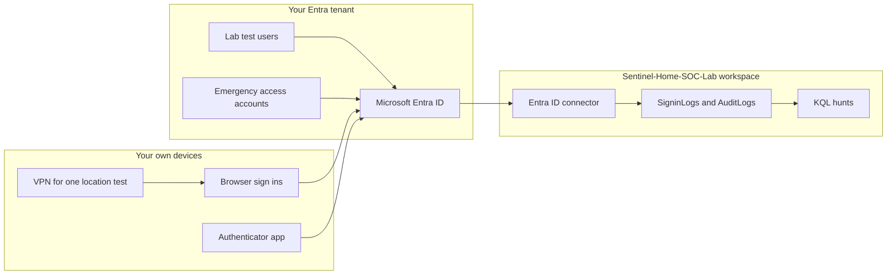

# Entra ID identity attack detection

This repository is a lab workbook. It shows how to simulate four common identity attacks against test users in a Microsoft Entra ID tenant you own, collect the sign-in and audit logs in Microsoft Sentinel, and hunt them with Kusto Query Language (KQL).

The Sentinel workspace comes from [Sentinel-Home-SOC-Lab](https://github.com/Sasa021/Sentinel-Home-SOC-Lab). Use that workspace. Do not create a second one for this project.

The results in this repo are placeholders. Screenshots, query counts, and lessons learned are added only after you run the lab and record what actually happened. An empty result is still a result. Write down what you saw.

## What the finished lab proves

When the evidence folder and the report are filled in with your own work, this project shows that you can:

* Prepare a small Entra ID tenant with test users and emergency access accounts, without putting a real organisation's data in the lab.
* Connect Microsoft Entra ID `Sign-in logs` and `Audit logs` to Microsoft Sentinel, and explain what the connector does and does not include.
* Recognise password spraying, an impossible or unfamiliar sign-in location, MFA fatigue, and suspicious account changes in the logs.
* Run and explain a KQL hunt for each of those behaviours on `SigninLogs` or `AuditLogs`.
* Describe the containment steps an analyst would take, and perform the safe ones on your own test users.
* Design Conditional Access policies for legacy authentication, MFA, named locations, and risk based sign-in, including which licence each policy needs.
* Choose a free control when the licence is not available. Security defaults are that control.
* Stop the lab without locking yourself out, and without leaving billable log ingestion running by accident.

## Skills and tools

* Microsoft Entra admin center: users, groups, roles, sign-in logs, audit logs, security defaults, Conditional Access, named locations
* Microsoft Sentinel and Log Analytics on the existing home SOC workspace
* KQL on `SigninLogs` and `AuditLogs`
* Microsoft Authenticator, on a phone you control
* A VPN you trust, used only to change your own sign-in country for one test
* MITRE ATT&CK, as a way to name the behaviour you simulated
* Entra ID Protection, only if your licence includes it

No paid attack tool is required. Do not use password spray tools, MFA prompt tools, or someone else's tenant.

## MITRE ATT&CK techniques

| Scenario | Technique | Tactic |
| --- | --- | --- |
| Password spraying | [T1110.003](https://attack.mitre.org/techniques/T1110/003/) Password Spraying, under [T1110](https://attack.mitre.org/techniques/T1110/) Brute Force | Credential Access |
| Impossible travel and unfamiliar location sign-ins | [T1078.004](https://attack.mitre.org/techniques/T1078/004/) Valid Accounts: Cloud Accounts | Initial Access, Persistence, Privilege Escalation, Defense Evasion |
| MFA fatigue (repeated push prompts) | [T1621](https://attack.mitre.org/techniques/T1621/) Multi-Factor Authentication Request Generation | Credential Access |
| New MFA method, or a new role assignment | [T1098](https://attack.mitre.org/techniques/T1098/) Account Manipulation. Role assignment is also [T1098.003](https://attack.mitre.org/techniques/T1098/003/) Additional Cloud Roles | Persistence, Privilege Escalation |

Identity Protection may also raise its own detections, such as `unlikelyTravel`, `unfamiliarFeatures`, `newCountry`, or `passwordSpray`. Those detections need Microsoft Entra ID P2. This lab does not depend on them. If they do not appear, record that.

## Architecture

You sign in from your own browser. Entra ID writes sign-in and audit events. The Entra ID data connector copies the two log types you select into the Sentinel workspace. You hunt in Log Analytics. Conditional Access policies are designs you can deploy later in report only mode. They are not assumed to be turned on.



## Repository structure

```text
README.md
LICENSE
.gitignore
docs/
  lab-guide.md                 How to run the lab, with exact settings
  screenshot-checklist.md      What to capture, and the file name to use
  report-template.md           Report to complete after the lab
evidence/
  README.md                    Redaction rules. No screenshots are included yet
scenarios/
  password-spray/              T1110.003
  impossible-travel/           T1078.004
  mfa-fatigue/                 T1621
  suspicious-changes/          T1098 and T1098.003
conditional-access/
  README.md                    Licence limits, security defaults, lockout rules
  *.json                       Policy and named location designs
  *.md                         Portal settings for each design
```

Each scenario folder contains:

* `simulation.md`, the safe method, limited to this tenant
* `detection.kql`, one query you can paste into Sentinel
* `response.md`, how an analyst contains the activity, and a place to record what you did

## How to reproduce

The full procedure, time estimates, and screenshot checkpoints are in [docs/lab-guide.md](docs/lab-guide.md). In short:

1. Read the cost and lockout warnings below, and in the lab guide, before you create any cloud object.
2. Use a tenant you own. Create four lab users and two emergency access accounts. Do not use a tenant that holds a real organisation's users or mail.
3. Set a budget alert on the existing Sentinel resource group, and confirm the Log Analytics daily cap, before you connect logs.
4. In Microsoft Sentinel, open the Microsoft Entra ID connector and select `Sign-in logs` and `Audit logs` only. Leave the noisy log types off.
5. Sign in once as a lab user and confirm a row arrives in `SigninLogs` or, if your licence cannot stream sign-in logs, in the Entra sign-in log view.
6. Run the four scenarios in [scenarios/](scenarios/). Stop at the limits written in each `simulation.md`.
7. Run each `detection.kql` and save the screenshots named in [docs/screenshot-checklist.md](docs/screenshot-checklist.md).
8. Review the Conditional Access designs in [conditional-access/](conditional-access/). Deploy them only in `Report-only`, and only if the licence allows it.
9. Copy [docs/report-template.md](docs/report-template.md), fill it in from your notes, and complete cleanup.

Plan on about 6 to 9 hours of active work, split across more than one day. The first log ingestion wait is the long part. Details and per part estimates are in the lab guide.

## Licences, cost, and cleanup

Use free tiers where they cover the work.

* **Entra ID Free** includes security defaults, short lived sign-in and audit views in the portal, and streaming of audit logs to Sentinel. Streaming **sign-in logs** to Sentinel needs **Entra ID P1 or P2**. Conditional Access needs **P1**. Identity Protection and risk based Conditional Access need **P2**. Source: [Send Microsoft Entra ID data to Microsoft Sentinel](https://learn.microsoft.com/azure/sentinel/connect-azure-active-directory).
* The Microsoft 365 Developer Program E5 sandbox is free only for eligible members, such as some Visual Studio subscribers and some partner or support programmes. It is not an open signup for every learner. If you are not eligible, do not pay for an E5 licence for this lab.
* A Microsoft 365 Business Premium trial includes Entra ID P1. An Entra ID P2 trial is sometimes offered in the portal. Read the trial screen before you accept it. If it asks for a card, you can decline and skip P2. Record the end date and cancel the trial in Microsoft 365 admin center billing before it can charge you.
* **Microsoft Sentinel** waives the first 10 GB per day for 31 days when it is first enabled on a workspace. That waiver may already be running, or finished, because of Sentinel-Home-SOC-Lab. Check `News & guides > Free trial` in your workspace and write down the dates. After the trial, `SigninLogs` and `AuditLogs` are paid. They are not in the free Office 365 or alert tables. Pricing: [Plan costs and understand Microsoft Sentinel pricing](https://learn.microsoft.com/azure/sentinel/billing) and the [Sentinel pricing page](https://azure.microsoft.com/pricing/details/microsoft-sentinel/). Read the price for your workspace region before you connect anything.
* Set a budget alert on the **existing** resource group. A daily cap of 1 GB is reasonable when this workspace is only ingesting a quiet lab. If the same workspace already needs more than that for another lab, do not lower the cap under that need. Use the budget alert instead.
* Select only `Sign-in logs` and `Audit logs`. Leave `Non-interactive user sign-in logs`, `Service principal sign-in logs`, and `Managed identity sign-in logs` off. Those tables grow quickly.
* Leave the tables on the Analytics plan. Basic and data lake plans are cheaper and will not run these hunts the way the lab expects. The daily cap is what limits spend.
* Cleanup does **not** mean deleting the Sentinel resource group. That group belongs to the other lab. Cleanup means: remove the lab role assignment, remove the extra MFA method, disable or delete the lab users, set lab Conditional Access policies to `Off` or delete them, turn security defaults back on if you are not keeping tested Conditional Access, disable any analytics rules you created, clear the two connector checkboxes when you no longer need the logs, disconnect the VPN, and check Cost Management the next day.

Conditional Access can lock every admin out of the tenant, including you. Create and test the emergency access accounts first. Keep one admin browser session open while you change policies. Leave new policies in `Report-only`. The details are in [conditional-access/README.md](conditional-access/README.md) and [docs/lab-guide.md](docs/lab-guide.md).

## Results

These fields stay blank until you finish the lab. Replace each placeholder in your report. Do not invent numbers here.

| Check | Your result |
| --- | --- |
| Tenant licence you actually had (Free, P1, P2, or a trial) | `[PLACEHOLDER]` |
| Sentinel free trial end date, if one was shown | `[PLACEHOLDER]` |
| Daily cap or budget alert you set | `[PLACEHOLDER]` |
| `SigninLogs` receiving data (yes, no, or licence blocked) | `[PLACEHOLDER]` |
| Password spray hunt output | `[PLACEHOLDER]` |
| Impossible travel hunt output | `[PLACEHOLDER]` |
| MFA fatigue hunt output | `[PLACEHOLDER]` |
| Suspicious change hunt output | `[PLACEHOLDER]` |
| Conditional Access deployed in report only, or left as designs | `[PLACEHOLDER]` |

## Lessons learned

Complete this after the lab, in your own words, in the report.

* What was harder than you expected: `[PLACEHOLDER]`
* Which query you had to tune, and what you changed: `[PLACEHOLDER]`
* Which control you would enable first in a real tenant with the licence you had, and why: `[PLACEHOLDER]`
* What you would do differently on a second run: `[PLACEHOLDER]`

## About me

Replace this section with a short bio in your own words if you want a different tone. Keep the links current.

Mosa Mofokeng is a junior Cyber Security Analyst in Cape Town, South Africa. She holds ISC2 CC and Microsoft SC-200. This repository is one of six portfolio labs she is building to show practical detection and response work.

* LinkedIn: add your profile URL here
* GitHub: [github.com/Sasa021](https://github.com/Sasa021)
